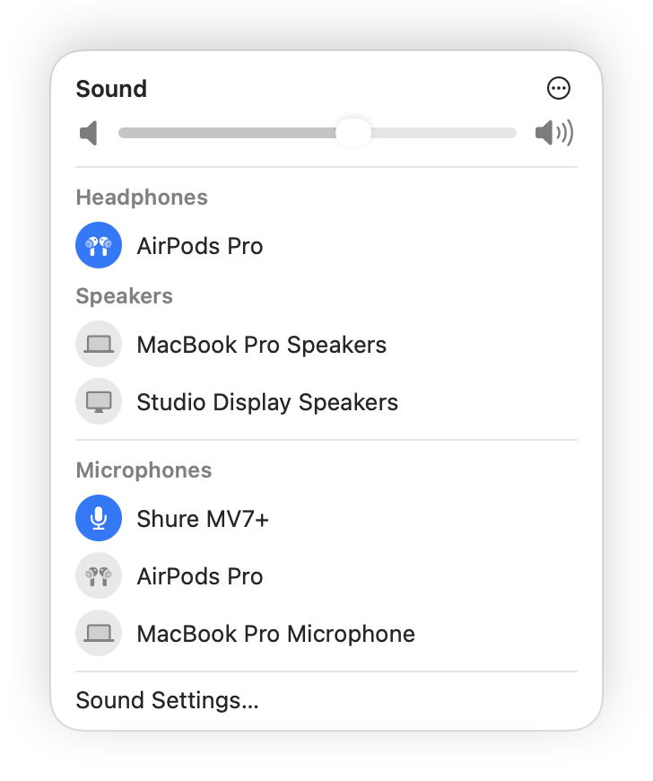

<p align="center">
  
</p>

<h1 align="center">SoundPin</h1>

<p align="center">
  Keep your Mac on the audio devices you chose.<br>
  A menu bar utility that prevents unwanted default device switches.
</p>

<p align="center">
  <a href="https://github.com/realruian/SoundPin/releases/latest"></a>
  
  
  
  
</p>

<p align="center">
  <a href="README.md">English</a> · <a href="README.zh-CN.md">简体中文</a>
</p>

<p align="center">
  
</p>

---

## Why

macOS does not offer a way to lock default audio input and output devices. When AirPods connect, the system automatically redirects the microphone to the headset. Connecting an external monitor or a dock often redirects audio output to monitor speakers unexpectedly.

SoundPin maintains priority lists for speakers, headphones, and microphones. Whenever a device connects or disconnects, or when macOS or another app changes the default device, SoundPin automatically switches back to the highest-ranked available device.

## Features

- **Priority-based switching**: Automatically routes audio to the highest-ranked connected device, and restores it when changed by other apps.
- **Separate headphone and speaker lists**: Routes to headphones when connected, and returns to desktop speakers when disconnected. Display audio (HDMI/DisplayPort) is filtered so it is never mistaken for headphones.
- **Click to promote**: Clicking any connected device selects it immediately. With automatic switching on, it also moves to the top of its priority list.
- **Scroll wheel volume control**: Hover over the volume slider and scroll to adjust the volume.
- **AirPods listening modes (experimental)**: Expand a supported device to select Transparency, Adaptive, or Noise Cancellation. Only reported modes are offered; routing and device priorities stay unchanged.
- **System-style panel**: Designed after the macOS Sound menu. The menu bar icon reflects volume level, mute state, and connected headphone models.
- **Offline device memory**: Disconnected devices remain in the list with last-seen timestamps, allowing you to organize priorities ahead of time.
- **Lightweight and private**: Driven by CoreAudio hardware event notifications without continuous polling. Requires no microphone recording permissions, makes no network requests, and collects no telemetry.
- **Keyboard and VoiceOver support**: Full VoiceOver support for reading device states and actions, plus Tab/Space navigation on macOS 14+.
- **Bilingual interface**: Supports English and Simplified Chinese, matching the system language by default.

Bluetooth battery levels appear for connected audio devices whose addresses match the macOS report. Hover for separate earbud and case values; the lower earbud level is displayed. Reads run at most once per minute while the panel is open. Unsupported devices show no value; case updates may be delayed.

## Installation

Compatible with Apple Silicon and Intel Macs running macOS 13 or later.

### Download

1. Download the latest `.dmg` from [Releases](https://github.com/realruian/SoundPin/releases/latest).
2. Open the disk image and drag `SoundPin` into Applications.
3. On first launch, if macOS warns that the developer cannot be verified, open System Settings > Privacy & Security and click Open Anyway. You can also remove the quarantine attribute via Terminal:
   ```bash
   xattr -dr com.apple.quarantine /Applications/SoundPin.app
   ```

**Upgrading from 2.1 or earlier (Audio Priority Bar)**:  
The app was renamed to SoundPin in version 2.2 with a new bundle identifier. Remove the old `AudioPriorityBar` from Applications after installing. Settings and priority orders migrate automatically on first launch; Open at Login should be re-enabled from the menu.

### Build from source

Requires Xcode 26 or later (the app icon is an Icon Composer file; the Command Line Tools alone cannot build the project):

```bash
git clone https://github.com/realruian/SoundPin.git
cd SoundPin
./install.sh
```

`install.sh` builds for this Mac's architecture, installs the app to `/Applications/SoundPin.app`, and opens it. Universal builds come from `tools/make-dmg.sh`.

## Usage

SoundPin runs in the menu bar as a speaker icon:

| Action | Result |
|---|---|
| Click a device | Selects it; with automatic switching on, also moves it to the top of its category |
| Drag a device | Reorders priorities |
| Scroll on volume slider | Adjusts output volume |
| Keyboard (macOS 14+) | With Keyboard Navigation on, press Tab to focus and Space/Return to select |
| Right-click a device row | Ignore device, never auto-select, or move between headphones and speakers |
| AirPods disclosure arrow | Expand or collapse Listening Mode; click a mode to select it |
| Top-right ⋯ menu | Toggle auto-switching, open at login, edit device list, switch language, quit |
| Edit Device List | Displays disconnected devices for reordering or removing |
| Sound Settings… | Opens macOS Sound settings |

When automatic switching is paused, pending routing retries are cancelled and an "Auto-Switch Paused" indicator appears in the header. Click it to resume.

Device inventory failures retain the previous display and suspend automatic selection, with at most two scheduled read retries. Manual selection is promoted only after the system default-device read-back matches. Failed switches receive at most two additional attempts, followed by a retry action. System read-back does not verify audible playback.

Drag and VoiceOver reorder actions identify endpoints by identity. Changes to list order, connection state, or category cancel a drag in progress. Hiding a device does not hide the active output’s volume, mute state, or headphone menu bar icon. Volume writes are read back, with the slider restored on failure; only a confirmed write may unmute the original output.

Listening-mode requests show a pending state until the system reports the requested mode. A timeout after roughly 3.7 seconds offers an explicit retry; writes are never repeated automatically. Disconnection or endpoint identity changes cancel pending requests, which are not replayed after reconnecting. Failed reads or listener registrations receive at most three scheduled recovery attempts. Previously discovered controls remain visible after read failure, with stale checkmarks cleared and selection disabled. Read-back describes the system cache, not an audible hardware confirmation.

## How it works

- **Device observation**: Uses CoreAudio C APIs (`AudioObjectAddPropertyListenerBlock`) to observe hardware changes and default device changes without polling.
- **Persistent storage**: Priorities are saved by device hardware UID in local preferences (`io.github.realruian.SoundPin`), preserving order across reconnects and reboots.
- **Device categorization**: Uses hardware transport types (`kAudioDevicePropertyTransportType`) and brand keywords to distinguish headphones from speakers.

Read local preferences:
```bash
defaults read io.github.realruian.SoundPin
```

## Known limitations

- **Listening modes are experimental**: This uses undocumented Core Audio HAL properties checked at runtime. Listening tests have passed on one AirPods Pro 3 while connected but not the default output. Default-output trials were interrupted by route changes and remain unverified. Checkmarks reflect the system cache, not a hardware acknowledgement.

- **Less common Bluetooth headphones**: Earbuds not matching the built-in keyword database may land in the speakers list initially. Select "Move to Headphones" from the device menu to fix this permanently.
- **AirPlay**: Disconnected AirPlay destinations do not appear in the list.
- **Bluetooth pairing**: Manages already-connected audio devices and does not initiate Bluetooth discovery or connection.

## Uninstall

If Open at Login is on, turn it off from the ⋯ menu first; otherwise an entry stays behind under System Settings → General → Login Items. Then quit the app from the ⋯ menu and run:

```bash
rm -rf /Applications/SoundPin.app
defaults delete io.github.realruian.SoundPin
```

If you upgraded from Audio Priority Bar, its old settings can be removed too:

```bash
defaults delete app.audioprioritybar
```

## Development

The repository includes helper scripts:

- `tools/render-preview.sh [output.png] [--demo] [--lang en|zh-Hans]`: Renders sample devices with in-memory preferences. The binary does not link real audio services or read the app's device priorities; `--demo` adds a presentation frame. `--listening-state ready|pending|failed|unavailable` renders a standalone listening-mode example.
- `tools/check-battery.sh [--live]`: checks battery parsing, exact address matching, cache invalidation, reconnection and report timeouts. `--live` also reads the local Bluetooth report. Add `--battery` to a preview for simulated levels.
- `tools/check-routing.sh`: Checks inventory failure, bounded retries, pause cancellation, confirmed manual selection and independent input/output connections using simulated audio and a virtual clock.
- `tools/check-interactions.sh`: Uses simulated devices to check identity-based reordering, stale-drag cancellation, hidden active state, volume write read-back and route changes during volume gestures.
- `tools/check-devices.sh`: Tests device classification and icon rules against sample devices.
- `tools/check-listening-modes.sh`: Checks supported modes, unknown values, invalid-device guards, and partial listener registration, recovery and cleanup using simulated hardware. No real device writes.
- `tools/check-listening-mode-requests.sh`: Checks pending requests, timeout, retry, disconnect cancellation, late notifications and bounded recovery using in-memory services and a virtual clock. It does not link the real listening-mode service.
- `tools/check-settings.sh`: Checks how devices are remembered and marked "never select automatically", using in-memory preferences without writing a preferences domain.
- `tools/check-events.sh`: Checks that a burst of device notifications is handled once, using test devices only this process sees.
- `tools/check-listening-mode-accessibility.sh`: verifies default mode actions, pending state, timeout and retry through Accessibility APIs in an isolated window with simulated devices; requires Accessibility permission.
- `tools/check-panel-acceptance.sh [--reduce-motion] [--record]`: checks expansion, rapid reversal and collapse (the panel window keeps its frame), accessibility actions and simulated requests in the real menu-bar panel. Requires Accessibility permission, plus Screen Recording for recording. Keep the desktop idle: dismissed menus or moving status items fail the check. This is an interactive diagnostic, not an unattended CI gate.
- `tools/check-voiceover.sh [--lang en|zh-Hans]`: Reads the panel's accessibility information without turning VoiceOver on and runs one row action (the terminal needs Accessibility permission).
- `tools/make-dmg.sh`: Builds a universal release binary and packages a DMG.

## Credits

Based on [tobi/AudioPriorityBar](https://github.com/tobi/AudioPriorityBar). Versions up to 2.1 retained the original name; the project was renamed to SoundPin starting in version 2.2.

Changes from the original:
- Redesigned interface following the macOS Sound menu;
- Clicking a device selects and promotes it to the top (original ignored clicks during auto mode);
- Scroll wheel support on the volume slider;
- Native bilingual interface (English and Simplified Chinese);
- Dynamic menu bar icon reflecting volume, mute, and headphone model;
- Transport type filtering preventing HDMI and DisplayPort from being classified as headphones;
- Offline device caching with recency timestamps;
- Full VoiceOver and keyboard navigation support;
- Layout fixes for modern macOS releases.

## License

[MIT](LICENSE)
